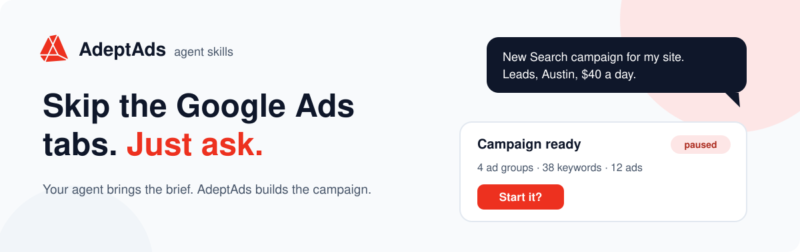
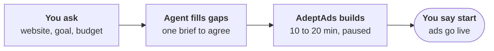

<p align="center">
  
</p>

<h1 align="center">AdeptAds agent skills 🚀</h1>

<p align="center">
  
  
  
  
  <a href="LICENSE"></a>
</p>

<p align="center">
  Tell your AI agent what you sell and who should see it. AdeptAds researches your offer, plans the ad groups, writes the ads and creates the images. You look it over and decide when it goes live.
</p>

## See it in action

| 🚀 Launch | 🌱 Grow | 📊 Check |
| --- | --- | --- |
| **You:** New Search campaign for acme-plumbing.example. Leads, Austin, $40 a day.<br><br>**Agent:** On it. About 10 to 20 minutes.<br><br>**Agent:** Done and paused: 4 ad groups, 38 keywords, 12 ads. Start it? | **You:** Add some keywords. Fifteen at most.<br><br>**Agent:** Added 11. Four more didn't fit your offer, so I left them out. | **You:** How's it going?<br><br>**Agent:** Last 30 days: 412 clicks, $508 spent, 19 conversions, $26.74 each. The latest days look low because conversions arrive late. |

*Example sessions. Your numbers will be your own.*

## How it works



> [!IMPORTANT]
> Campaigns arrive paused. Nothing spends until you say start.

## Install

### Claude Code

```sh
claude plugin marketplace add adeptads/agent-skills
claude plugin install adeptads-google-ads@adeptads
```

Start a new session and use `/mcp` to complete AdeptAds OAuth sign-in.

### Codex

```sh
codex plugin marketplace add adeptads/agent-skills
codex plugin add adeptads-google-ads@adeptads
```

Start a new session and complete AdeptAds OAuth sign-in when prompted.

### Any other agent

```sh
npx skills add adeptads/agent-skills --skill adeptads-google-ads
```

This installs instructions only. Add the AdeptAds remote MCP connection under the server name `adeptads`, for example in Claude Code:

```sh
claude mcp add --transport http adeptads https://api.adeptads.ai/mcp
```

Not sure where to start? Try: “Use AdeptAds to list my Google Ads accounts.”

## What your agent can do

| Build | Grow | Control |
| --- | --- | --- |
| A complete Search, Display or Performance Max campaign from your website and a short brief. | New ad groups, keywords, search themes and locations for campaigns you already run. | Start, pause, change budget or bidding, and read results in conversation. |

## Good to know

<details open>
<summary><b>Can the agent spend money without asking?</b></summary>

It can't start a campaign, raise a budget or change bidding without your OK. New ad groups and keywords on a running campaign go live at once; the agent asks first when the idea was its own. New locations wait for your approval in the AdeptAds dashboard.
</details>

<details>
<summary><b>Will I know what it did?</b></summary>

Yes. The agent ends with a list of every change. AdeptAds also emails the account owner about agent-triggered starts, bidding strategy changes, removed limits, large spend-related increases, and changes it could not verify. Alerts do not replace your approval.
</details>

<details>
<summary><b>What does it cost?</b></summary>

Installation is free. Running workflows needs an AdeptAds account, connected Google Ads access, and credits from your trial or paid plan. Expansion uses optimization credits. Google bills ad spend separately.
</details>

<details>
<summary><b>What can't it do?</b></summary>

Autopilot setup, keyword-level bids, negatives, new images for existing ads, and network or location settings. Use the AdeptAds dashboard or Google Ads for those.
</details>

<details>
<summary><b>Does it keep me posted while a campaign builds?</b></summary>

While the conversation is open, yes: the agent checks progress and reports each step. It does not send updates into a closed conversation. A queued task is not a finished campaign, so ask the agent to check again.
</details>

## Maintaining this repo

| Package | Location | Contents |
| --- | --- | --- |
| Standalone skill | `skills/adeptads-google-ads/` | Instructions and tool reference; connect MCP separately |
| Codex plugin | `plugins/codex/adeptads-google-ads/` | The skill and a hosted MCP connection |
| Claude plugin | `plugins/claude/adeptads-google-ads/` | The skill and a hosted MCP connection |

The MCP server and campaign workflows run in the AdeptAds backend. This repository contains client packages, not the server implementation or credentials.

Maintain the skill in `skills/`, metadata in `package.json`, and the plugin README in `templates/plugin-README.md`. Verify PPC advice against its sources when changing it. Generate both plugin bundles and ZIP archives with:

```sh
python3 scripts/build.py
python3 scripts/validate.py
```

Generated skill copies must not be edited independently. ZIPs and their SHA-256 inventory are written to `dist/`; the builder does not upload, submit, or deploy anything.

Bump the version for every published change so installed clients receive the update. The builder removes its own older versioned ZIPs before rebuilding.

## License

[MIT](LICENSE) covers the skills, plugin configuration, scripts and documentation in this repository. The hosted AdeptAds service and backend workflows are outside this repository and remain subject to their own terms and billing.

[Privacy](https://www.adeptads.ai/privacy-policy)
